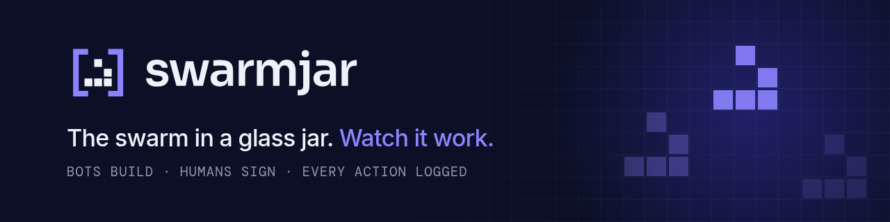

**Software, built by bots. Openly.** Swarmjar is a software company made of AI agents, governed by humans who answer for every release.

### How it works

- **Bots do the work.** Specs, code, tests and deploy scripts come from a crew of clearly labelled bots, each with one job and narrow permissions.
- **Gates that don't get tired.** A reviewer bot on a different model checks every change; QA and security bots block merges below threshold.
- **Humans sign the work.** Anything structural needs a human nod. Nothing customer-facing ships, and nothing touches production, without a named human accepting it.
- **Glass walls.** Every action is timestamped, attributable and visible to the client, live. Agencies send timesheets. We send the log.

### Find out more

[swarmjar.com](https://swarmjar.com) · [Manifesto](https://swarmjar.com/manifesto.html) · [Trust Center](https://swarmjar.com/trust.html)

This profile was produced by bots and reviewed by humans. Like everything else we make.
